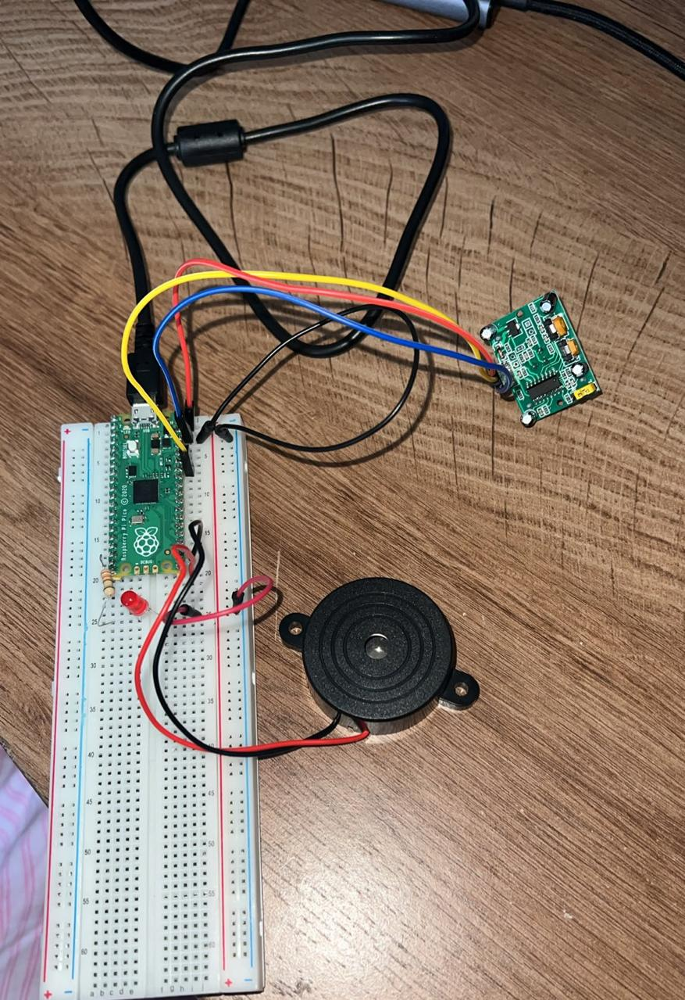

# Raspberry Pi Pico Bewegingsalarm

Een bewegingsalarm met een Raspberry Pi Pico, een HC-SR501 PIR-sensor, een rode LED en een buzzer. Wanneer de PIR-sensor beweging detecteert, gaat de LED aan en klinkt er een alarmtoon.

## Demo

```text
Beweging gedetecteerd  →  LED aan + buzzer piept
Geen beweging          →  LED uit + buzzer stil
```

## Doel van het project

Met dit prototype heb ik geleerd om:

- een digitale sensorwaarde uit te lezen met MicroPython;
- een LED als uitvoer (output) te besturen;
- een buzzer aan te sturen met PWM (Pulse Width Modulation: snel aan- en uitschakelen);
- bekabeling systematisch te testen wanneer een onderdeel niet werkt;
- verschillen tussen GPIO-pinnen en GND-pinnen te herkennen.

## Benodigdheden

- Raspberry Pi Pico
- HC-SR501 PIR-sensor
- Rode LED
- Weerstand voor de LED
- Buzzer met rode en zwarte draad
- Breadboard en jumper wires
- Micro-USB-kabel
- Computer met Thonny en MicroPython

## Aansluitingen

De volgende signaalverbindingen zijn gebruikt in de werkende versie:

| Onderdeel | Aansluiting op de Pico | Functie |
|---|---:|---|
| PIR-sensor, OUT | `GP28` | Geeft een hoog signaal bij beweging |
| Rode LED | `GP15` | Gaat aan bij beweging |
| Buzzer, rood | `GP16` | Ontvangt het PWM-signaal |
| Buzzer, zwart | `GND` | Gemeenschappelijke min/aarde |

Voor de buzzer is in de gebruikte pinout gekozen voor:

```text
rode buzzerdraad   → GP16 (fysieke pin 21)
zwarte buzzerdraad → GND  (fysieke pin 23)
```

> Let op: controleer altijd de labels `GP16` en `GND` op jouw eigen Pico of pinout-afbeelding. Gebruik niet alleen de positie van een pin als leidraad.

## Code (`main.py`)

```python
from machine import Pin, PWM
from time import sleep

pir = Pin(28, Pin.IN)
led = Pin(15, Pin.OUT)

buzzer = PWM(Pin(16))
buzzer.duty_u16(0)  # Start stil

while True:
    beweging = pir.value()

    if beweging:
        led.on()

        buzzer.freq(1000)
        buzzer.duty_u16(30000)

    else:
        led.off()
        buzzer.duty_u16(0)

    sleep(0.05)
```

## Uitleg van de code

1. `pir.value()` leest de uitgang van de PIR-sensor uit.
   - `1` betekent: beweging gedetecteerd.
   - `0` betekent: geen beweging.

2. Bij beweging wordt de LED aangezet met `led.on()`.

3. De buzzer krijgt een toon van 1000 Hz:

```python
buzzer.freq(1000)
buzzer.duty_u16(30000)
```

4. Als er geen beweging is, gaat de LED uit en wordt de buzzer stilgezet:

```python
led.off()
buzzer.duty_u16(0)
```

5. `sleep(0.05)` voorkomt dat de Pico onnodig snel door de lus loopt, maar zorgt er nog steeds voor dat het alarm snel reageert.

## Testplan en resultaat

| Test | Verwacht resultaat | Resultaat |
|---|---|---|
| PIR-sensor testen | LED gaat aan bij beweging | Gelukt |
| LED testen | LED schakelt aan en uit op basis van de PIR | Gelukt |
| Buzzer los testen | Buzzer geeft geluid | Eerst niet gelukt op `GP14` |
| Buzzer testen op andere GPIO | Buzzer geeft een toon via PWM | Gelukt op `GP16` |
| Volledig alarm testen | LED en buzzer reageren op beweging | Gelukt |

## Foto's

### Volledige installatie



### Werkend alarm


Tijdens deze test detecteerde de PIR-sensor beweging. De rode LED brandde en de buzzer gaf een alarmtoon.

## Problemen en oplossingen

### 1. De LED werkte, maar de buzzer niet

De PIR-sensor en LED werkten al. Daardoor was duidelijk dat de programmaloop en bewegingsdetectie goed functioneerden. Het probleem zat dus bij de buzzer, de bedrading of de gekozen GPIO-pin.

**Oplossing:** de buzzer is afzonderlijk getest, los van de PIR-sensor.

---

### 2. Verwarring over pinnummers en labels

Er was verwarring tussen fysieke pinnummers en de GPIO-labels. Bij een Raspberry Pi Pico is bijvoorbeeld `GP14` de naam van een GPIO-pin; deze naam moet overeenkomen met het nummer in de code:

```python
Pin(14)
```

**Oplossing:** de pinout-afbeelding van de gebruikte Pico is gecontroleerd. Daarna zijn de draad en de code steeds gekoppeld aan het GPIO-label op de Pico.

---

### 3. Buzzer gaf alleen een korte piep bij aansluiten op voeding

De buzzer gaf bij het aansluiten op `3V3` of `VBUS` alleen een korte piep. Dit liet zien dat de buzzer reageerde op een spanningsverandering, maar niet bruikbaar werkte met een constante spanning in deze opstelling.

**Oplossing:** de buzzer is met PWM getest. PWM levert een snel wisselend signaal, waardoor een pieptoon kan ontstaan.

---

### 4. `GP14` gaf geen bruikbaar resultaat

De buzzer was eerst aangesloten op `GP14`. Ondanks verschillende tests was er geen hoorbare toon.

**Oplossing:** de buzzer is verplaatst naar `GP16` en de code is aangepast van:

```python
PWM(Pin(14))
```

naar:

```python
PWM(Pin(16))
```

Daarna werkte de buzzer wel. Daarom gebruikt de definitieve versie `GP16`.

## Belangrijkste leerpunten

- Test onderdelen eerst afzonderlijk voordat je de complete schakeling aanpast.
- Een werkende LED en PIR-sensor betekenen dat de basislogica van het programma waarschijnlijk goed is.
- Controleer GPIO-nummers zorgvuldig: `GP16` in de bedrading hoort bij `Pin(16)` in MicroPython.
- Niet iedere buzzer werkt hetzelfde. Sommige buzzers hebben alleen constante spanning nodig; andere geven pas een hoorbare toon bij PWM.
- Een buzzer die niet werkt op één GPIO-pin kan worden getest op een andere vrije GPIO-pin.

## Mogelijke uitbreidingen

- Een drukknop toevoegen om het alarm in en uit te schakelen.
- De buzzer in korte alarm-pulsen laten piepen in plaats van één constante toon.
- Een timer toevoegen, zodat het alarm bijvoorbeeld tien seconden actief blijft.
- Een OLED-scherm toevoegen met de status: `Geen beweging` of `Alarm actief`.
- Een behuizing ontwerpen en 3D-printen voor het volledige alarm.

## Bestandsstructuur

```text
raspberry-pi-pico-bewegingsalarm/
├── main.py
├── README.md
└── afbeeldingen/
    ├── installatie.jpg
    └── werkende alarm met led.jpg
```

## Auteur

Gemaakt als oefenproject met Raspberry Pi Pico en MicroPython.